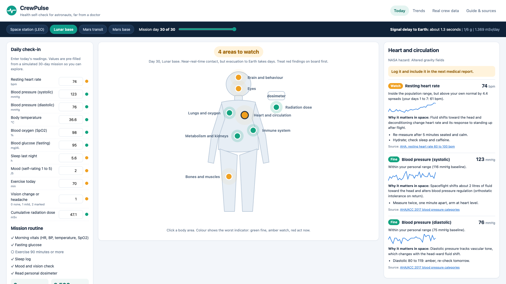
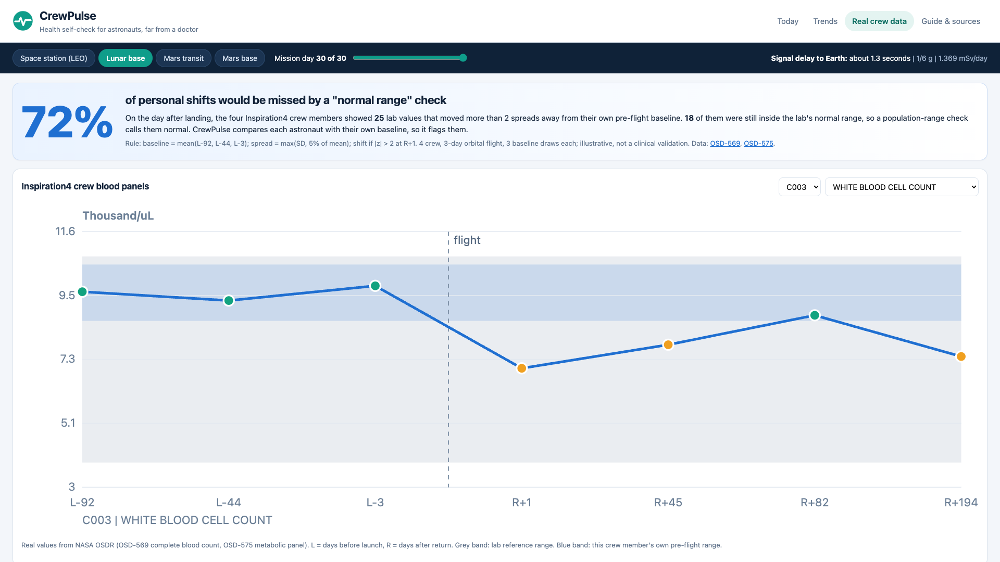

# CrewPulse

**A health self-check that knows each astronaut's own normal.**
NASA Space Apps Challenge 2026, challenge *Create Health Monitoring Software for Astronauts on Space Missions*.

**Team:** Team Baseline &nbsp;|&nbsp; NASA Space Apps Challenge 2026, Jeddah

**Live demo:** `https://<user>.github.io/crewpulse/` &nbsp;|&nbsp; **30 s video:** [media/CrewPulse_demo_30s.mp4](media/CrewPulse_demo_30s.mp4)



## What it does

| View | What you get |
|---|---|
| **Today** | Daily check-in of 11 indicators, a clickable body map coloured green / amber / red, and for each area: what the value means, why spaceflight affects it (NASA HRP hazard), what to do now and when to escalate, with sources. |
| **Trends** | 30-day timeline of any indicator with the population band, the personal band and alert points. |
| **Real crew data** | NASA OSDR Inspiration4 blood panels (OSD-569 CBC, OSD-575 metabolic panel) for 4 crew and 7 time points, with lab range and personal pre-flight band. |
| **Guide & sources** | How decisions are made, how to measure each indicator on board, and every source. |

The mission bar switches between space station, lunar base, Mars transit and Mars base. Signal delay, gravity and daily radiation rate change, and so does the advice: red findings far from Earth trigger "start the on-board protocol now, report after".

## Key finding (real NASA data)



On the day after landing, Inspiration4 crew showed **25** lab values more than 2 spreads away from their own pre-flight baseline. **18 of 25 (72%)** were still inside the lab's normal range, so a population-range check calls them normal. Rule: baseline = mean of L-92, L-44, L-3; spread = max(SD, 5% of mean); flag if |z| > 2. Caveat: 4 crew, 3-day flight; illustrative, not clinical validation.

## Run it

Open `index.html`. No build step, no libraries, works offline.

Refresh the NASA data (Python 3, standard library):

```bash
python3 scripts/build_dataset.py
```

Shareable deep links, for example `index.html?env=transit&day=30&region=heart&set=sys:186` (pre-sets a reading) or `index.html?view=i4&crew=C003&an=WHITE%20BLOOD%20CELL%20COUNT`.

## Files

```
index.html          app shell
css/style.css       styles
js/data.js          generated from NASA OSDR (do not edit by hand)
js/domains.js       environments, indicators, thresholds, regions, sources
js/sim.js           seeded, labelled 30-day simulated vital-sign log
js/app.js           rules engine, body map, charts
scripts/build_dataset.py   downloads OSD-569 and OSD-575 and computes the analysis
data/i4_labs.json   processed lab data and analysis summary
data/raw/           original OSDR CSV files
```

## Deploy on GitHub Pages

Push to a public repository, then Settings > Pages > Deploy from a branch > `main` / root.

## Sources

NASA OSDR [OSD-569](https://osdr.nasa.gov/bio/repo/data/studies/OSD-569) and [OSD-575](https://osdr.nasa.gov/bio/repo/data/studies/OSD-575); NASA HRP [hazards](https://www.nasa.gov/hrp/hazards/) and [risks](https://www.nasa.gov/hrp/risks/); NASA OCHMO radiation technical brief (600 mSv career limit); Zhang et al. 2020, Zeitlin et al. 2013, Hassler et al. 2014 for dose rates; AHA, ADA and AASM/SRS reference values; CSA radiation monitoring resource. Full list in the app's Guide tab.

## Limits and SI disclosure

Educational prototype, not a medical device. The 30-day vital-sign log is simulated and labelled; lab data is real. Code and text were written with SI assistance (Claude, Anthropic) and reviewed by the team; the demo narration is SI-generated (Kokoro TTS) and watermarked. No NASA branding is used. Not endorsed by NASA.

## License

MIT, see [LICENSE](LICENSE).
